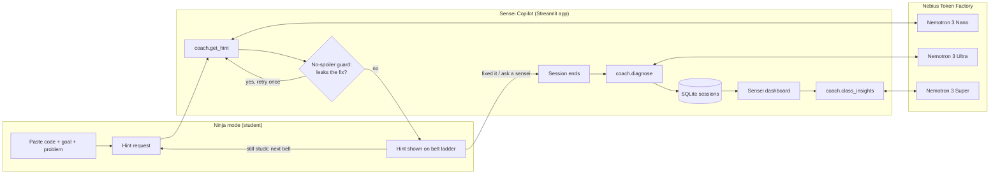
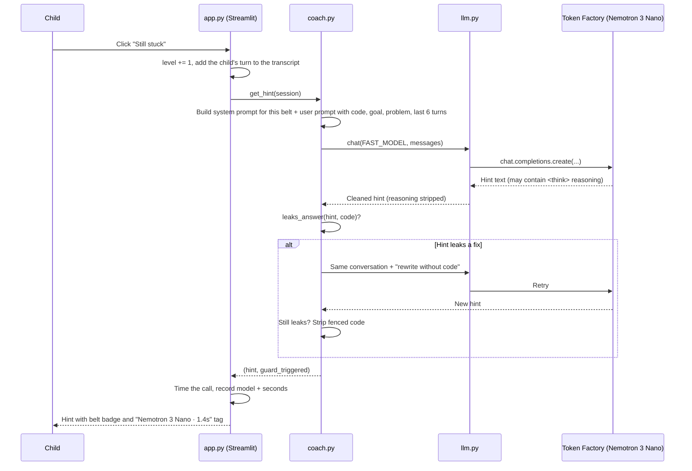

# Sensei Copilot: Project Report

**A coding coach for children that gives graded hints but never the answer.**

| | |
|---|---|
| **Author** | Thino ([@thinojen](https://github.com/thinojen)) |
| **Event** | Nebius x NVIDIA Global AI Hackathon, 2026 |
| **Track** | Best Apps and Agents |
| **Models** | NVIDIA Nemotron 3 Nano, Super and Ultra, served by Nebius Token Factory |
| **Stack** | Python 3.9+, Streamlit, OpenAI Python SDK, SQLite, pandas |
| **Licence** | MIT |
| **Report date** | 29 October 2026 |

---

## Contents

1. [Summary](#1-summary)
2. [The problem](#2-the-problem)
3. [The solution](#3-the-solution)
4. [Architecture](#4-architecture)
5. [AI design: models, prompts and routing](#5-ai-design-models-prompts-and-routing)
6. [The no-spoiler guard](#6-the-no-spoiler-guard)
7. [Teaching and product decisions](#7-teaching-and-product-decisions)
8. [Interface and visual design](#8-interface-and-visual-design)
9. [Engineering decisions](#9-engineering-decisions)
10. [Safety, privacy and security](#10-safety-privacy-and-security)
11. [Testing and verification](#11-testing-and-verification)
12. [Problems found during the build and how they were fixed](#12-problems-found-during-the-build-and-how-they-were-fixed)
13. [Cost](#13-cost)
14. [Hackathon requirements checklist](#14-hackathon-requirements-checklist)
15. [Limitations and risks](#15-limitations-and-risks)
16. [Roadmap](#16-roadmap)
17. [Appendix: configuration and file map](#17-appendix-configuration-and-file-map)

---

## 1. Summary

Sensei Copilot has two sides:

- **Ninja mode** is for students aged 7–15. A child pastes code that isn't working, says what they wanted it to do and what actually happens, and gets one hint at a time. Hints climb a four-level "belt ladder" from a gentle question to pointing at the exact line. The model is never allowed to write the fix: the child always types it.
- **The Sensei dashboard** is for the tutor. Every finished session is diagnosed into a programming concept and a specific misconception. The tutor sees where the class gets stuck and who needs a check-in, and can generate a 10-minute group mini-lesson in one click.

The app routes each job to the Nemotron model that suits it. **Nano** writes every hint because a child is waiting. **Ultra** does the deep reasoning about *why* a child made a mistake, once per session, after the child has finished. **Super** summarises the whole class for the tutor. All three run on Nebius Token Factory through its OpenAI-compatible API.

The defining design choice is a **two-layer refusal to give the answer**: a system prompt that forbids corrected code, plus a deterministic code check (the "no-spoiler guard") that catches any hint which leaks a fix and makes the model rewrite it.

---

## 2. The problem

I work as a Code Sensei at a children's coding club, teaching JavaScript, Small Basic and AI/ML to under-16s. The same three problems come up every session.

1. **Stuck children lose momentum.** One tutor looks after a room full of children. A child who gets stuck puts their hand up and waits. By the time the tutor arrives, the child has often lost interest or started messing about.
2. **General chatbots teach the wrong thing.** Children increasingly paste their code into a general-purpose AI assistant. It helpfully returns the corrected code. The program now works, but the child has learned nothing about debugging, which is the actual skill.
3. **The tutor can't see patterns.** Helping children one at a time, a tutor rarely notices that six of them hit the same misconception this week. That pattern is exactly what should shape the next lesson.

The opportunity is an assistant that behaves like a good tutor (asks questions, points in the right direction, explains the concept, and lets the child do the fixing) and that reports back to the human tutor what the class is struggling with.

---

## 3. The solution

### 3.1 Student journey (Ninja mode)

1. The child picks an example or pastes their own code, and fills in three things: a ninja name (first name or nickname only), what they **want** the program to do, and what **actually** happens.
2. They click **Help me, Sensei!** and get a **White belt** hint: a single question that makes them compare what they expected with what happened.
3. They can reply in the chat box (for example "I think it goes one too far"), and Sensei responds at the same level.
4. If they're still stuck, they click **Still stuck** to climb a belt:

   | Belt | Hint level | What the hint does |
   |---|---|---|
   | White | Nudge | One question comparing expected with actual behaviour. Says nothing about where the bug is. |
   | Yellow | Look here | Points to the general area of the code ("your loop", "the part that draws the circle"). Doesn't say what's wrong. |
   | Orange | Big idea | Names the concept and explains it with a tiny example that is *not* their program, then asks how it applies. |
   | Black | Spot it | Points to the exact line and describes in words what's going wrong and why. Still no corrected code. |

5. When they fix it, they click **I fixed it!** They get balloons, a message saying which belt they solved it at ("You fixed it yourself at Yellow belt level!"), and a five-minute practice challenge that targets the misconception they just had.
6. If they reach Black belt and are still stuck, **Ask a real sensei** ends the session as unsolved and flags them on the tutor's dashboard.

### 3.2 Tutor journey (Sensei dashboard)

The dashboard shows:

- **Headline numbers:** sessions, percentage solved independently, average hint level reached, and number of children helped.
- **Where the class gets stuck:** a bar chart of sessions per concept.
- **Needs a check-in:** every child who didn't solve their bug or needed the maximum hint, with the specific misconception.
- **Class insights:** one button that asks Nemotron Super for the top three patterns, who to check in on, and a 10-minute group mini-lesson built around a memorable analogy.
- **All sessions** and **per-session detail:** the misconception, the evidence (the code fragment that shows it), a tip for the tutor on how to explain it, and the practice task.

A tutor can optionally lock the dashboard with a PIN (`SENSEI_PIN`) so students can't open it.

---

## 4. Architecture

### 4.1 Overview



The child only ever waits on the fast model. The slower, deeper models run after the session has ended or when the tutor asks for them.

### 4.2 Request lifecycle for one hint



### 4.3 Modules

| File | Responsibility | Why it is separate |
|---|---|---|
| `app.py` | Streamlit interface: theme, belt ladder, Ninja mode, dashboard, timing tags | UI changes never touch AI logic |
| `sensei/llm.py` | Token Factory client, model routing, mock switch, reasoning clean-up, retries | One place to change the provider or a model |
| `sensei/coach.py` | Hint ladder, no-spoiler guard, diagnosis, class insights | The "brains", testable without the UI |
| `sensei/prompts.py` | Every prompt, the hint levels and the concept list | Prompts can be tuned without touching code |
| `sensei/db.py` | SQLite storage and demo data | Storage can be swapped (for example to PostgreSQL) in one file |
| `sensei/mock.py` | Canned responses when there's no API key | Lets the app run and be tested offline |
| `check_models.py` | Lists the account's NVIDIA models and pings the three in use | Confirms model IDs before deploying |

### 4.4 Data model

One table, `sessions`, written once per finished session:

| Column | Type | Contents |
|---|---|---|
| `id` | integer | Primary key |
| `created_at` | text | ISO timestamp |
| `student` | text | Ninja name (first name or nickname only) |
| `language` | text | JavaScript, Small Basic or Python |
| `goal` | text | What the child wanted the program to do |
| `code` | text | The child's original code |
| `hints_used` | integer | Highest belt reached (1–4) |
| `solved` | integer | 1 if the child fixed it, 0 if they asked a sensei |
| `concept` | text | One of 14 fixed concepts, from the diagnosis |
| `misconception` | text | One sentence: what the child believes that isn't true |
| `diagnosis` | text (JSON) | Full diagnosis: concept, misconception, evidence, confidence, practice task, tutor tip |

The concept and misconception are stored as their own columns so the dashboard can count and chart them without parsing JSON.

---

## 5. AI design: models, prompts and routing

### 5.1 Model routing

| Job | Model | When it runs | Why this model | Alternative considered | Why not |
|---|---|---|---|---|---|
| Every hint | **Nemotron 3 Nano** (`nvidia/NVIDIA-Nemotron-3-Nano-30B-A3B`) | Every time the child asks or replies | A child is waiting, so speed matters most. It runs many times per session, so it must be cheap. An 80-word hint doesn't need frontier reasoning. | Super or Ultra for every hint | Slower and more expensive for little gain on short hints. Children lose focus while waiting. |
| Session diagnosis | **Nemotron 3 Ultra** (`nvidia/Nemotron-3-Ultra-550b-a55b`) | Once, when the session ends | Inferring *why* a child made a mistake from their code, their goal and the conversation is genuine reasoning. It runs after the child has finished, so its speed costs nobody. | Nano for everything | A smaller model is more likely to give vague labels ("syntax error") rather than a specific misconception the tutor can act on. |
| Class insights | **Nemotron 3 Super** (`nvidia/nemotron-3-super-120b-a12b`) | When the tutor clicks Generate | Summarising many sessions needs more than Nano, but not Ultra-level reasoning. A tutor clicking a button will wait a few seconds. | Ultra | Better quality is unlikely to justify the extra wait and cost for a summary. |

This follows the track brief directly: *"Reach for Nemotron 3 Ultra when you need serious reasoning, and let Nano or Super handle the fast, everyday calls."*

All model IDs are read from environment variables (`SENSEI_FAST_MODEL`, `SENSEI_MID_MODEL`, `SENSEI_SMART_MODEL`), so a renamed model can be fixed without a code change. `check_models.py` confirmed all three IDs against a live Token Factory account on 29 October 2026.

### 5.2 Why Nebius Token Factory

| Option | Verdict |
|---|---|
| **Token Factory (chosen)** | OpenAI-compatible, so the standard `openai` SDK works by changing only the base URL. Nano, Super and Ultra sit behind one endpoint, so switching is a one-string change. Ultra (550B parameters) runs serverless, with no GPUs to provision. |
| Self-host on Nebius AI Cloud (DevPods, Serverless Endpoints) | More control, but far more setup for a two-day solo build, and no benefit at demo scale. It's the natural step for production. |
| A different provider | Doesn't meet the hackathon requirement. |

### 5.3 Prompt design

All prompts live in `sensei/prompts.py`.

**Hint prompt.** The system prompt sets one golden rule ("NEVER give the answer"), spelled out as concrete prohibitions: never write corrected code, never rewrite their lines, never put fixed code in a code block. It then sets the style for a young audience: warm, encouraging, under about 80 words, simple words, one idea at a time, at most one emoji. The model may quote a single short fragment of the child's *own* code to point at it. If the code already works, it should say so and ask what they'd like to add. If the child goes off-topic, it steers them back to coding. Finally it injects the current belt's name and instruction.

The user prompt carries the language, the child's goal, the problem they described, their code, and the last six turns of conversation. Six turns keeps the context focused and the prompt small (and therefore cheap and fast), while still letting Sensei respond to what the child just said.

**Diagnosis prompt.** Ultra receives the whole session (code, goal, problem, hints needed, whether it was solved, and the transcript) and must return **only a JSON object** with six fields: `concept`, `misconception`, `evidence`, `confidence`, `next_exercise` and `sensei_note`.

- The concept must come from a **fixed list of 14** (Variables, Data types, Conditionals, Loops, Functions, Arrays/lists, Syntax, Events & input, Scope, Strings, Maths & operators, Boolean logic, Coordinates & graphics, Program flow). A fixed list means the dashboard can group and count sessions. If the model returns something outside the list, the code falls back safely rather than crashing.
- JSON is extracted robustly: the code finds the first `{...}` block in the reply, so the parse still works if the model wraps it in prose or code fences.

**Insights prompt.** Super receives one line per session (student, language, concept, misconception, hints, solved) and writes markdown with exactly three parts: top three patterns citing numbers, who needs a check-in, and a 10-minute mini-lesson with one memorable analogy, all under 250 words. The word limit and the required analogy stop it producing a generic essay.

### 5.4 Handling Nemotron's reasoning output

Nemotron models can "think" before answering. Two practical problems came from this:

1. **Reasoning text in the output.** `llm.clean()` strips `<think>...</think>` blocks, including an unclosed block if the reply was cut off.
2. **Reasoning eats the token budget.** Reasoning tokens count towards `max_tokens`. With an early budget of 900 tokens, the class insights were cut off mid-sentence. The fix was a bigger default budget (2,000 for hints, 4,000 for diagnosis and insights), plus an automatic retry: if the API reports `finish_reason == "length"`, the call is repeated once with double the budget, up to 8,000.

**Alternative considered:** switching reasoning off per request. It wasn't confirmed as supported on Token Factory without live experimentation, and an unsupported parameter could break every call, so it was too risky this close to the deadline. It's listed as a future optimisation.

### 5.5 Mock mode

If no `NEBIUS_API_KEY` is set (or `SENSEI_MOCK=1`), `llm.chat()` returns canned responses from `sensei/mock.py`: one hint per belt, a sample diagnosis and a sample insights write-up. The mock reads the belt level out of the system prompt so it climbs the ladder realistically.

This allowed the whole interface to be built and tested before API credits were set up, and it means the app fails gracefully rather than crashing if the key is missing. The sidebar always shows which mode is active: a green "Live on Nebius Token Factory" badge or a yellow "Mock mode" warning. Every hint is also tagged "mock response" in mock mode, so a mock demo can never be mistaken for a live one.

---

## 6. The no-spoiler guard

### 6.1 Why prompting alone is not enough

LLMs are trained to be helpful, and for a coding question "helpful" usually means "here's the fixed line". Even with a strict system prompt, a model will sometimes slip the fix in, especially at the higher belts where it's describing the exact line. For a tool whose whole purpose is to *not* give the answer, one leaked fix undermines the product. So there's a second, deterministic layer that doesn't depend on the model behaving.

### 6.2 How it works

After every hint, `coach.leaks_answer(hint, student_code)` returns true if:

1. **The hint contains a fenced code block** (```` ``` ````). Hints are never supposed to contain code blocks, so any fence is treated as a leak.
2. **An inline code snippet looks like a rewritten version of one of the child's lines.** For each `` `inline code` `` snippet:
   - whitespace is removed from the snippet and from each of the child's lines, so formatting differences don't matter;
   - snippets shorter than 12 characters are allowed (pointing at `i <= length` is fine);
   - a snippet identical to one of the child's own lines is allowed (quoting their code is how hints point at things);
   - otherwise, if the snippet shares a long common prefix or suffix (at least half its length, and at least 5 characters) with one of the child's lines, it's treated as a modified version of their line, which is a leaked fix.

If a leak is found:

1. The model is asked to **rewrite the hint** in the same conversation, with the instruction: "Your last reply included code that gives away the fix. Rewrite the hint WITHOUT any code blocks or corrected code - describe it in words instead."
2. If the rewrite **still** leaks, any fenced code is **stripped** and replaced with "(I'll let you type this part yourself!)".
3. The hint is marked as guarded, and the interface shows "🛡️ no-spoiler guard rewrote this hint" so the tutor (and judges) can see it working.

**Example.** The child's line is `for (let i = 0; i <= scores.length; i++) {`. A hint containing `` `i <= scores.length` `` passes: it's short and quotes their code. A hint containing `` `for (let i = 0; i < scores.length; i++) {` `` is caught: it's long, isn't their line, and shares a long prefix with it.

### 6.3 Alternatives considered

| Alternative | Why not chosen |
|---|---|
| Trust the system prompt alone | Prompts reduce leaks but don't eliminate them. |
| A second LLM call to judge every hint | Doubles latency and cost on the call where speed matters most. |
| Block every hint that contains any code | Too strict: pointing at the child's own code is how good hints work. |
| Full code-diff or AST comparison | More accurate, but needs a parser per language (JavaScript, Small Basic, Python) and wasn't feasible in two days. |

### 6.4 Known gaps

The guard is a heuristic. A fix described cleverly in plain words ("change the less-than-or-equals to less-than") isn't code, so it passes. That's intentional at the Black belt, which is meant to describe the problem in words, but it could be too revealing at lower belts. Measuring how often the guard triggers on real sessions is the next step (see the roadmap).

---

## 7. Teaching and product decisions

| Decision | What was chosen | Why | Alternatives considered | Why not |
|---|---|---|---|---|
| Never give the answer | Forbidden at every level, enforced by prompt and guard | Debugging is the skill being taught. A copied fix teaches nothing. It's also the clearest difference from a general chatbot. | Reveal the fix after N hints | Children would learn to click "stuck" until the answer appears. A child who needs more than Black belt needs a human. |
| Fixed hint ladder | Four levels: Nudge, Look here, Big idea, Spot it | Mirrors how a good tutor scaffolds help. Help gets more specific only when the child asks. It's predictable, and it's measurable ("solved at level 2"). | Let the model decide how much to reveal | Unpredictable: it might give away too much on the first try. It also produces no comparable measure. |
| Child-driven escalation | The child presses "Still stuck" to climb | Puts the child in control and makes asking for more help a deliberate choice. | Escalate automatically after a time limit | Children work at very different speeds, and a timer adds pressure. |
| Conversational replies | Chat box at the current belt | Lets the child answer Sensei's question, which is where real learning happens, without jumping a level. | Buttons only | Turns it into a hint vending machine. |
| "Ask a real sensei" | Ends the session as unsolved and flags the child | The AI supports the tutor and never replaces them. A stuck child always has a human route. | Unlimited AI help | A child stuck past Black belt needs a person, not more text. |
| Practice challenge | A five-minute task targeting the misconception, shown after the session | Fixing one bug doesn't mean the misconception is gone. A quick related task consolidates it. | No follow-up | Misses the best moment to reinforce learning. |
| Specific misconceptions | One sentence about what the child believes, plus the evidence | "Loops" isn't actionable. "Thinks `<=` stops at the last item" tells the tutor exactly what to teach. | Concept label only | Too vague to plan a lesson from. |
| Analogy in the mini-lesson | Required by the insights prompt | Children remember analogies ("the staircase", "the bouncer checking IDs") much better than rules. | Plain explanation | Less memorable for young learners. |

---

## 8. Interface and visual design

Design is one of the four judging criteria ("a complete, coherent product experience, not just a technical proof of concept"), so the interface was treated as part of the product rather than an afterthought.

| Decision | What was chosen | Why | Alternatives considered | Why not |
|---|---|---|---|---|
| Overall style | "Playful and bright": warm cream background with a dot pattern, orange-to-yellow accents, chunky outlined cards and buttons that press down when clicked, rounded fonts (Baloo 2 for headings, Nunito for text) | It's for children and should feel like a game, not a work tool. Thick outlines and offset shadows give a friendly, cartoon-like look. | Dark "dojo" theme; clean minimal SaaS; retro arcade | Considered and offered as options. Playful and bright suits the youngest users best and is easy to read on classroom screens. |
| Belt ladder | Hint levels drawn as karate belts with a knot; the current belt lifts and turns orange; every hint carries a matching badge | Children at coding clubs already know the ninja and dojo language. "Fixed it at Yellow belt" makes needing fewer hints something to be proud of. | Numbered steps; points or XP | Numbers feel like a test. Points invite gaming the system. |
| Landing banner | "Stuck on your code?" with three steps: Paste your code, Get a hint, Fix it yourself | Explains the whole product in one glance, including that the child does the fixing. | Plain heading | Doesn't set expectations. |
| Built-in examples | Three realistic bugs: JavaScript off-by-one (total shows NaN), Python `input()` string vs number, Small Basic Y-axis direction | A judge or new user can try it in one click. Each bug matches a real, common misconception. | Empty form | Most visitors won't have broken code ready to paste. |
| Visible model tags | Every AI output shows which model answered and how long it took, e.g. "Nemotron 3 Nano · 1.4s · Nebius Token Factory" | Shows the model routing working rather than just describing it: fast Nano for hints, slower Ultra for diagnosis. | Model list in the sidebar only | Easy to miss, and says nothing about speed. |
| Celebration | Balloons and the belt achieved when a child fixes their bug | Positive reinforcement for debugging independently. | Plain success message | Less motivating for children. |
| Two-column session view | Conversation on the left, the child's code, goal and problem on the right | The child can look at their code while reading the hint, which is how debugging actually works. | Single column | The code scrolls out of view. |

The theme is set in `.streamlit/config.toml` (colours, light mode, rounded corners) and extended with CSS in `app.py`. Light mode is forced so the design looks the same on every classroom computer.

---

## 9. Engineering decisions

| Decision | What was chosen | Why | Alternatives considered | Why not |
|---|---|---|---|---|
| UI framework | **Streamlit** | All Python, which I already know. Chat bubbles, buttons, charts, metrics and free hosting with very little code. | React + FastAPI; Gradio | React means writing and connecting a separate frontend and backend, which doubles the work for a solo two-day build. Gradio suits single-model demos better than a two-sided product with a dashboard. |
| Hosting | **Streamlit Community Cloud** | Free, deploys from GitHub, redeploys automatically on every push, and stores the API key in its Secrets manager. | Nebius Serverless Endpoints | Encouraged by the track but not required. More setup for no demo benefit. It's the natural production step. |
| API client | **Official `openai` Python SDK** with Token Factory's base URL | Token Factory is OpenAI-compatible, so no custom HTTP code or new SDK is needed. | Raw HTTP requests; an agent framework | More code to write, or a heavy dependency for three simple calls. |
| Storage | **SQLite**, one file | Zero setup, built into Python, enough for one club. | PostgreSQL; Firebase | Needs a server or account and adds setup with no gain at this scale. |
| State | **Streamlit session state** for the active session; the database only for finished sessions | Unfinished sessions don't clutter the tutor's data. | Saving every turn | Adds partial sessions that skew the statistics. |
| Code structure | Five small modules (see 4.3) | Prompts can be tuned without touching logic, a model can be swapped in one place, and coaching logic can be tested without the UI. | One `app.py` | Faster to start, but much riskier to change under deadline pressure. |
| Configuration | **Environment variables**, with Streamlit Secrets as a fallback | The same code runs locally and in the cloud, and no secret ever lives in a file. | Hard-coded values or a config file | Hard-coded model IDs break when a model is renamed. A config file risks committing secrets. |
| Error handling | API errors are caught and shown as a red message; the app keeps running | A network hiccup shouldn't crash a child's session. | Let exceptions propagate | A crash loses the child's progress. |
| Python version | Works on Python 3.9 (using `from __future__ import annotations`) | macOS ships Python 3.9 in its command-line tools, and that's what the development laptop used. | Require 3.10+ | Would have forced a Python install before testing. |
| Demo data | One button that loads 9 realistic sessions with evidence, tips and practice tasks, replacing any earlier demo rows | The dashboard needs data to be meaningful in a three-minute video. | Ask real students | No time, and real children's data shouldn't appear in a public demo. |

---

## 10. Safety, privacy and security

The users are under 16, so the app collects as little as possible and keeps the human tutor in control.

| Area | What was done | Why | Alternative considered | Why not |
|---|---|---|---|---|
| Student identity | First name or nickname only, max 20 characters. No accounts, emails, ages or schools. | Data minimisation for children. Nothing stored identifies a child outside the club. | Student logins | Adds personal data and parental-consent questions for no teaching gain. |
| Tone and topic | The prompt keeps replies warm, short and age-appropriate, and steers off-topic chat back to code | Children will type anything. Keeping the coach on task keeps it safe and useful. | A separate moderation model on every message | More latency and cost. Planned for production. |
| Human in the loop | "Ask a real sensei" button; struggling children flagged on the dashboard | The AI supports the tutor and doesn't replace them. | Fully automated tutoring | Removes the safeguard of a person who knows the child. |
| Dashboard access | Optional `SENSEI_PIN` | Stops students opening class-wide data. | Full user accounts | Too heavy for one club. |
| Data location | Local SQLite file controlled by the club | Session data stays with the club. | Cloud database | Moves children's data off-site for no benefit at this scale. |
| Demo data | Fictional names and invented sessions only | No real child's data is in the repository or the public demo. | Real anonymised sessions | Not worth the privacy risk for a demo. |

### 10.1 API key handling

The repository is public, so keeping the Nebius API key out of it was treated as a hard requirement.

- The key is **only ever read at runtime** with `os.getenv("NEBIUS_API_KEY")`, falling back to Streamlit's `st.secrets`. It's never written to any file by the app.
- Locally, the key is set in the terminal with `export`, which lasts only for that terminal session.
- In the cloud, the key is stored in **Streamlit Cloud's Secrets manager**, which keeps it out of the repository and hidden from visitors.
- `.gitignore` excludes `.env`, `.streamlit/secrets.toml`, the database file and Python caches.
- The repository contains only `.streamlit/secrets.toml.example`, with a placeholder value (`"your_token_factory_key"`).
- Before publishing this report, every file **and the full git history** were scanned for anything resembling a key (long random tokens, `sk-` prefixes, Token Factory key formats, and any assignment of a real value to `NEBIUS_API_KEY`). Nothing was found. The only matches are placeholder text in documentation and the example secrets file.
- The key was never pasted into the development chat or into any screenshot.

If a key were ever exposed, the fix would be to delete it in the Token Factory dashboard and create a new one. Deleting it from GitHub alone is not enough, because it would remain in the git history.

---

## 11. Testing and verification

| Test | How | Result |
|---|---|---|
| Full user journey | Automated run with Streamlit's `AppTest`, in mock mode: load an example, request a hint, climb two belts, reply in chat, click "I fixed it", open the dashboard, load demo data, generate insights | Passed after every code change; no exceptions |
| New Python example | Automated run selecting "Python - guess the number" and requesting a hint | Passed |
| No-spoiler guard | Unit checks: a fenced code block is caught; a rewritten version of the child's loop line is caught; quoting the child's own fragment is allowed | All three behave as intended |
| Demo data | Loading demo data twice in a row | 9 sessions, not 18 (no duplicates) |
| Visual check | Headless Chromium (Playwright) screenshots of the landing page, an active session and the dashboard | Layout, belt ladder and theme render correctly |
| Live models | `check_models.py` against a real Token Factory account | All three Nemotron models found and responding ("OK") |
| Live app | Running locally with a real key | Green "Live on Nebius Token Factory" badge; dashboard working with live data. The fix for cut-off insights was verified in mock mode and is pending a live re-check. |

**Not yet tested:** the quality of live Nemotron hints across many real student bugs, and how often the guard triggers in practice. That needs real sessions (see section 15).

---

## 12. Problems found during the build and how they were fixed

| Problem | Cause | Fix |
|---|---|---|
| Class insights cut off mid-sentence ("Off-by-one belief") | Nemotron's reasoning tokens counted towards a 900-token limit | Bigger token budgets, plus an automatic retry at double the budget when the API reports the reply was cut short |
| Demo sessions appeared twice (18 instead of 9) | "Load demo data" appended a new set on every click | Demo loading now deletes earlier demo rows first, so it can be clicked safely any number of times |
| Demo session detail said only "Demo data." | Placeholder text in the seed data | Each demo session now has realistic evidence, a tutor tip and a practice task |
| Streamlit warning about `use_container_width` | Deprecated argument in newer Streamlit | Replaced with `width="stretch"` |
| `streamlit: command not found` on macOS | pip installed the command into a folder not on the PATH | Run the app with `python3 -m streamlit run app.py` (documented) |
| `export: not valid in this context` in zsh | Spaces around `=` when setting the key | Documented the correct form: `export NEBIUS_API_KEY="..."` with no spaces |
| Sign-up asked for billing details | Token Factory requires billing information | Used the Builder Program credit. Expected cost is a fraction of the credit (section 13). |

---

## 13. Cost

These are **approximate** per-call costs, worked out from published per-million-token prices for Token Factory (Nano about \$0.06 in / \$0.24 out; Super about \$0.30 / \$0.90; Ultra about \$1.00 / \$3.00 per million tokens, as listed by a third-party gateway in October 2026) and rough token counts including reasoning. Real costs depend on prompt length and how much the model reasons.

| Call | Approx. tokens (in / out) | Approx. cost |
|---|---|---|
| One hint (Nano) | 1,000 / 600 | \$0.0002 |
| One diagnosis (Ultra) | 1,500 / 1,000 | \$0.0045 |
| One class insights (Super) | 1,000 / 1,500 | \$0.002 |
| **A typical session** (4 hints + 1 diagnosis) | | **about \$0.005** |

At about half a cent per session, a club of 20 children with 3 sessions each per week would cost roughly \$0.30 a week. The routing design is what makes this cheap: the expensive model runs once per session, and the cheap model handles the many hint calls.

---

## 14. Hackathon requirements checklist

| Requirement | How Sensei Copilot meets it |
|---|---|
| Runs on Nebius Token Factory or AI Cloud | Every hint, diagnosis and insight is a runtime call to the Token Factory inference API |
| Uses at least one NVIDIA open-source model | Three: Nemotron 3 Nano, Super and Ultra |
| Fits a track | **Best Apps and Agents**: a copilot people would actually use, with Ultra for serious reasoning and Nano/Super for fast everyday calls, as the track describes |
| Working demo URL | Streamlit Community Cloud deployment (link in the Devpost submission) |
| Public repository with an open-source licence | This repository, MIT licence shown in the About section |
| README with setup instructions | `README.md`: install, set the key, verify models, run, deploy |
| Highlights Nemotron and Token Factory usage | README sections "How it uses NVIDIA Nemotron on Nebius Token Factory" and "Where Token Factory accelerated the workflow", plus sections 5 and 13 of this report |
| Demo video under 3 minutes | Public YouTube video (link in the Devpost submission) |
| Feedback on Nebius and NVIDIA tools | Submitted with the Devpost entry |
| New during the submission period | Built from scratch on 28–29 October 2026 |

---

## 15. Limitations and risks

1. **Hint quality hasn't been validated with real children or tutors.** The prompts are based on tutoring experience, but haven't been tuned against live Nemotron output across many real bugs. This is the biggest open risk.
2. **The guard is a heuristic.** It catches code blocks and near-copies of the child's lines, but not a fix described entirely in words (section 6.4).
3. **Single club, single tutor.** No sensei accounts, multiple classes or long-term student history.
4. **Storage on the free hosting is temporary.** Streamlit Community Cloud can reset its filesystem when the app restarts or redeploys, which clears the demo's sessions. That's fine for a demo but not for a real club.
5. **Three languages and 14 concepts.** Other languages (Scratch, Lua, C#) and finer-grained concepts aren't covered yet.
6. **No moderation model.** Off-topic or inappropriate input is handled only by the prompt.
7. **Reasoning cost and latency.** Nemotron's reasoning makes some calls slower and use more tokens than strictly needed. Per-request control of reasoning wasn't tested.
8. **Diagnosis can be wrong.** Ultra infers a misconception from limited evidence. The diagnosis includes a confidence field and evidence so the tutor can judge it, but it is a suggestion, not a verdict.

---

## 16. Roadmap

**Next (validation)**
- [ ] Pilot with one class at a coding club, with tutor feedback on hint quality
- [ ] Log how often the guard triggers, by belt level, and tune prompts to reduce it
- [ ] Collect tutor ratings of diagnoses to measure accuracy

**Then (production readiness)**
- [ ] Deploy on Nebius Serverless Endpoints with a hosted database for persistent storage
- [ ] Sensei accounts, with separate dashboards per class and per club
- [ ] Lightweight moderation check on student messages
- [ ] Test switching reasoning off for Nano hints to cut latency

**Later (deeper learning)**
- [ ] Track each child's progress over time: fewer hints needed for the same concept means learning
- [ ] Tutor-editable concept lists and hint styles for each club
- [ ] More languages, starting with Scratch and Lua
- [ ] Weekly email summary for the tutor, generated by a scheduled Nebius Serverless Job

---

## 17. Appendix: configuration and file map

### 17.1 Environment variables

| Variable | Default | Purpose |
|---|---|---|
| `NEBIUS_API_KEY` | none | Token Factory API key. Required for live mode. Set in the terminal or Streamlit Secrets, never in a file. |
| `NEBIUS_BASE_URL` | `https://api.tokenfactory.nebius.com/v1/` | Token Factory endpoint |
| `SENSEI_FAST_MODEL` | `nvidia/NVIDIA-Nemotron-3-Nano-30B-A3B` | Hint model |
| `SENSEI_MID_MODEL` | `nvidia/nemotron-3-super-120b-a12b` | Class insights model |
| `SENSEI_SMART_MODEL` | `nvidia/Nemotron-3-Ultra-550b-a55b` | Diagnosis model |
| `SENSEI_PIN` | none | Optional PIN that locks the dashboard |
| `SENSEI_MOCK` | `0` | Set to `1` to force mock mode |
| `SENSEI_DB` | `sensei.db` | Path to the SQLite file |

### 17.2 File map

```
sensei-copilot/
├── app.py                       Streamlit interface: theme, belt ladder, Ninja mode, dashboard
├── check_models.py              Verifies model IDs against your Token Factory account
├── requirements.txt             streamlit, openai, pandas
├── README.md                    Setup, run and deploy instructions
├── LICENSE                      MIT
├── .gitignore                   Excludes .env, secrets.toml, sensei.db, caches
├── .streamlit/
│   ├── config.toml              Theme (colours, light mode, rounded corners)
│   └── secrets.toml.example     Placeholder only. Copy to secrets.toml locally
├── docs/
│   └── PROJECT_REPORT.md        This report
└── sensei/
    ├── llm.py                   Token Factory client, routing, reasoning clean-up, retries, mock switch
    ├── coach.py                 Hint ladder, no-spoiler guard, diagnosis, class insights
    ├── prompts.py               All prompts, hint levels, concept list
    ├── db.py                    SQLite storage, demo data
    └── mock.py                  Canned responses for offline mode
```

### 17.3 Running it

```bash
git clone https://github.com/thinojen/sensei-copilot.git
cd sensei-copilot
pip install -r requirements.txt

export NEBIUS_API_KEY="your_key"      # no spaces around =
python3 check_models.py               # expect OK for all three models
python3 -m streamlit run app.py       # opens http://localhost:8501
```

Without a key, run `SENSEI_MOCK=1 python3 -m streamlit run app.py` to explore the interface with canned responses.
